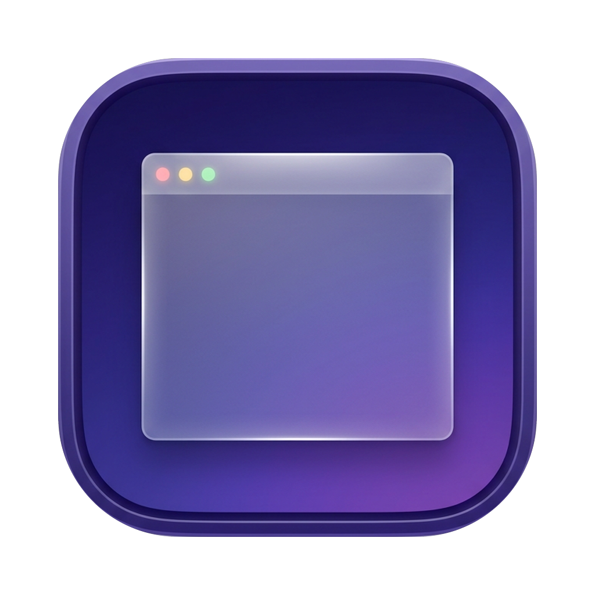
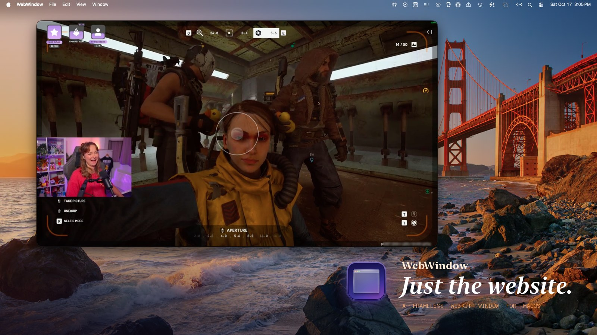
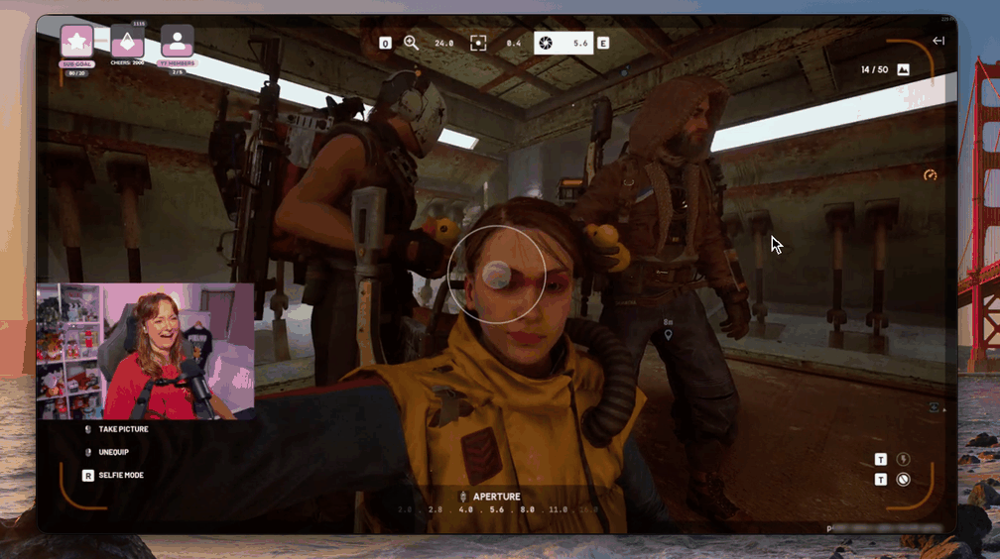

<p align="center">
  
</p>

<h1 align="center">WebWindow</h1>

<p align="center"><em>Just the website.</em></p>

<p align="center">
  <a href="LICENSE"></a>
  
  
  
</p>

<br>



<br>

Every browser wants to be your workspace. Tabs, toolbars, sidebars, extensions, a URL bar that never stops asking for attention.

**WebWindow wants to be a window.** One site, one native macOS window, nothing around it. Park a stream next to your editor, pin a dashboard on a second monitor, keep a chat open without a browser eating half the screen. It's ~240 lines of Swift on top of the WebKit engine that already ships with your Mac.

<br>

## Now you see it. Now you don't.

The title bar is gone until you want it. Touch the top edge of the window and a frosted bar fades in with the traffic lights and the page title. Drag it to move the window, double-click it to zoom. Move away and it disappears.

<p align="center">
  
</p>

<br>

## Install

You need the Xcode Command Line Tools (`xcode-select --install` if you don't have them).

```sh
git clone https://github.com/metaskills/webwindow.git
cd webwindow
make install
```

That builds the app and copies it to `/Applications`, where Spotlight, Launchpad, and the Dock treat it like any other app. Type <kbd>⌘</kbd> <kbd>Space</kbd> and "WebWindow".

Prefer not to touch `/Applications`? Install for just your user:

```sh
make install PREFIX=~/Applications
```

To remove it: `make uninstall` (same `PREFIX` if you used one).

<br>

## Use

Launch it and it asks where to go. The default is `https://www.twitch.tv`, and it remembers the last place you went. Type `example.com` and it adds the `https://` for you.

| Keys | Does |
| --- | --- |
| <kbd>⌘</kbd> <kbd>L</kbd> | Open a new location |
| <kbd>⌘</kbd> <kbd>R</kbd> | Reload |
| <kbd>⌘</kbd> <kbd>[</kbd> / <kbd>⌘</kbd> <kbd>]</kbd> | Back / forward (two-finger swipe works too) |
| <kbd>⌃</kbd> <kbd>⌘</kbd> <kbd>F</kbd> | Full screen |
| <kbd>⌘</kbd> <kbd>W</kbd> / <kbd>⌘</kbd> <kbd>Q</kbd> | Close / quit |

Links that try to open a new tab load in the same window. Video fullscreen and autoplay work.

<br>

## Your logins

macOS keeps Safari's cookies private to Safari, so no other app can borrow them. WebWindow keeps its own persistent cookies, cache, and local storage instead. Sign in once and you stay signed in. Everything lives in:

```
~/Library/WebKit/com.kencollins.webwindow
~/Library/HTTPStorages/com.kencollins.webwindow.binarycookies
```

Delete those to log out of everything.

<br>

## What it isn't

No tabs. No toolbar. No preferences. No extensions. No telemetry. No updater. No dependencies. If you need any of those, you already have a browser.

<br>

## How it's made

| | |
| --- | --- |
| `main.swift` | The whole app. AppKit + `WKWebView`, no Xcode project. |
| `Info.plist` | Bundle metadata. |
| `Makefile` | `build`, `install`, `uninstall`, `run`, `clean`. |
| `AppIcon.icns` | Built from `icon/AppIcon-1024.png`. |
| `icon/` | The icon source and the two variants that didn't make it, with the prompts that made them. |

The icon was generated by Google's Nano Banana, prompted by Gemini through the Gemini CLI. The code, the README, and the art direction were made with Claude Code.

<br>

## Notes for agents working in this repo

- Build with `make build`, run with `make run`. There are no tests; verify changes by launching the app.
- Keep it one file and zero dependencies. Resist adding UI: the product is the absence of UI.
- The bundle ID `com.kencollins.webwindow` keys the cookie store. Changing it logs every user out.
- To rebuild the icon after editing `icon/AppIcon-1024.png`, render an `.iconset` with `sips` at 16/32/128/256/512 (plus @2x) and run `iconutil -c icns`.

<br>

## License

Public domain, via [The Unlicense](LICENSE). Copy it, fork it, sell it, rename it. No credit needed.

<br>

<p align="center">
  <br>
  <sub>Made with ❤️ and <a href="https://www.anthropic.com/claude">Claude Opus 5.5</a></sub>
</p>
